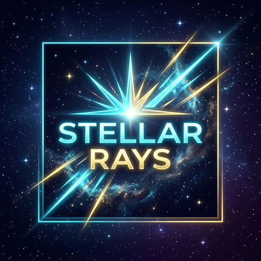

<div align="center">



# ✨ Stellar Rays

**Purely client-side visual enhancement, camera control, and ray rendering mod for Minecraft.**

[](https://www.minecraft.net/)
[](https://quiltmc.org/)
[](https://kotlinlang.org/)
[](https://adoptium.net/)
[](#-technical-details)

</div>

---

## 📖 About

**Stellar Rays** is a dedicated 100% client-side visual enhancement mod in the Stellar suite. It provides customizable ray tracing vectors, targeted line-of-sight visualizers, customizable gamma boost, and advanced rendering utilities without requiring any server-side dependencies.

---

## ⚙️ Features

* **Targeted Ray Tracing:** Visual line-of-sight ray indicators with customizable distance, thickness, and color.
* **Fullbright Boost:** Enhanced gamma boost for clear visibility in dark environments.
* **Cloth Config & ModMenu:** Fully integrated GUI configuration with hot-reloading settings.
* **Pure Client Execution:** Zero server-side packets or dependencies; safe for all client installations.

---

## 🛠️ Build & Development

```bash
# Build mod JAR
./gradlew :stellar-rays:build

# Run tests
./gradlew :stellar-rays:test

# Run Detekt linter
./gradlew :stellar-rays:detekt
```
